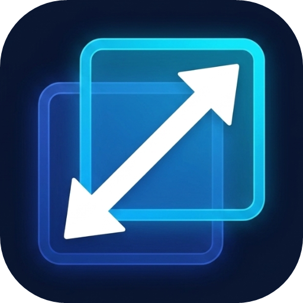

<div align="center">



# ReScale

**Universal Multi-Monitor DPI Normalizer for Windows 10 & 11**

*Fixes the notorious Windows mixed-DPI scaling bug where closed applications reopen tiny or oversized when switching displays or undocking your laptop.*

[](https://microsoft.com)
[](https://dotnet.microsoft.com/)
[](LICENSE)

</div>

---

## 📌 The Problem

If you connect a laptop with a high-density display (e.g. **2.5K / 4K @ 150% or 200% scale**) to an external monitor (e.g. **1080p @ 100% scale**), you have likely run into this frustrating Windows behavior:

1. You open an application (such as **Task Manager**, **File Explorer**, or **Chrome**) on your 1080p external monitor, size it to your liking, and **close it**.
2. When closed, Windows applications save their window dimensions as **raw, hardcoded physical pixel numbers** (e.g. `750px × 580px`) directly into the registry or local configs.
3. You **unplug your laptop** and launch the application on your 150% laptop screen.
4. The application reads `750px × 580px` from its config. Because your laptop has dense pixels and $1.5\times$ larger UI scaling:
   * **Task Manager collapses into responsive compact mode:** columns disappear, the search bar shrinks to an icon, and navigation tabs are cut off.
   * Windows appear **miniature, cramped, and unusable**.
5. You stretch the window on your laptop so you can read it, and **close it** (saving `1125px × 870px`).
6. You **plug your external monitor back in** and launch the app.
7. It reads `1125px × 870px` on a 1080p canvas ($1920 \times 1080$), opening **significantly oversized** and taking over almost the entire screen.

### Why Windows Built-In Settings Don't Fix This
Windows 11 includes options like *"Remember window locations based on monitor connection"*, but these **only apply to windows that stay open while pulling or plugging the cable**. The second an application is closed, Windows completely discards its topology memory. When reopened, the app simply restores its hardcoded raw pixels with zero DPI translation.

---

## 💡 The Solution: ReScale

**ReScale** is an ultra-lightweight, event-driven background utility that automatically intercepts application launches and restores them to their **exact intended visual scale** on whichever monitor they spawn.

```
┌─────────────────────────────────┐           ┌─────────────────────────────────┐
│     1080p External Monitor      │           │      2.5K Laptop Display        │
│          DPI = 96 (100%)        │           │        DPI = 144 (150%)         │
│                                 │           │                                 │
│   ┌─────────────────────┐       │           │   ┌─────────────────────────┐   │
│   │   Task Manager      │       │  Unplug   │   │     Task Manager        │   │
│   │   750px × 580px     │───────┼──────────►│   │     1125px × 870px      │   │
│   │   (Fits all columns)│       │           │   │     (Fits all columns)  │   │
│   └─────────────────────┘       │           │   └─────────────────────────┘   │
│                                 │◄──────────┼─────────────────────────────────┤
│                                 │  Plug in  │                                 │
└─────────────────────────────────┘           └─────────────────────────────────┘
```

### The Universal Scaling Formula

Whenever any window opens, the engine compares the monitor DPI where the window was last saved (`SavedDPI`) with the monitor DPI where it just spawned (`CurrentDPI`):

$$\text{Target Width} = \text{Saved Width} \times \left(\frac{\text{Current DPI}}{\text{Saved DPI}}\right)$$

$$\text{Target Height} = \text{Saved Height} \times \left(\frac{\text{Current DPI}}{\text{Saved DPI}}\right)$$

* **1080p (96 DPI / 100%) $\rightarrow$ 2.5K (144 DPI / 150%):** Multiplies dimensions by **$1.5\times$**.
* **2.5K (144 DPI / 150%) $\rightarrow$ 1080p (96 DPI / 100%):** Multiplies dimensions by **$0.67\times$** ($1 \div 1.5$).
* **1080p (96 DPI / 100%) $\rightarrow$ 4K (192 DPI / 200%):** Multiplies dimensions by **$2.0\times$**.
* **Any Custom Scale Setup:** Works dynamically across any resolution and scaling combinations.

---

## ✨ Key Features

* 🎯 **Strict DPI-Only Trigger:** If an app opens on the **same DPI monitor** where it was saved, the engine **never touches it**. Your windows remain completely natural on their home screens.
* 🛡️ **Zero Internal Layout Tampering:** Only adjusts the outer window frame boundaries `(X, Y, Width, Height)`. Never sends synthetic messages or interferes with internal child controls, allowing modern WinUI 3, XAML Islands (File Explorer, Settings), and Electron apps to calculate their own layout naturally.
* ⚡ **Full Administrator / UIPI Support:** Compiled with an Administrator manifest so it has full authority to manage elevated system windows (Task Manager, Regedit, Device Manager) without being blocked by Windows User Interface Privilege Isolation (UIPI).
* 🧠 **Self-Learning:** Zero manual configuration required. Whenever you manually resize any window on any monitor, the engine automatically remembers your preferred size and its associated DPI.
* 🪶 **Near-Zero Resource Usage:** Uses asynchronous, event-driven OS hooks (`SetWinEventHook`). It consumes **0% CPU** and rests completely idle until a window is launched or resized.
* ⌨️ **Global Hotkeys:**
  * <kbd>Ctrl</kbd> + <kbd>Alt</kbd> + <kbd>S</kbd>: Instantly force-normalize the currently active window.
  * <kbd>Ctrl</kbd> + <kbd>Alt</kbd> + <kbd>A</kbd>: Normalize all open application windows across all displays.

---

## 🚀 Quick Start

### 1. Run Pre-Compiled Binary
1. Clone or download this repository.
2. Double-click **`Run-ReScale.bat`** (or execute `publish\ReScale.exe`).
3. Click **Yes** on the Windows UAC prompt (required to manage elevated windows like Task Manager).
4. The tool will sit silently in your **Windows System Tray** (near the clock).

### 2. Auto-Start with Windows
* Right-click the system tray icon and check **"Start with Windows"**.

---

## 🛠️ Building from Source

### Prerequisites
* Windows 10 (Version 1809+) or Windows 11
* [.NET 10.0 SDK](https://dotnet.microsoft.com/download/dotnet/10.0)

### Build Steps
```powershell
# Clone the repository
git clone https://github.com/achintha-umayanga/ReScale.git
cd "rescale"

# Restore dependencies
dotnet restore

# Build release executable
dotnet publish -c Release -o ./publish
```

The compiled binary will be located in the `publish/` directory.

---

## ⚙️ Architecture & Technical Highlights

* **Language:** C# / .NET 10
* **API Hooks:** `SetWinEventHook` listening for `EVENT_OBJECT_SHOW` (window creation) and `EVENT_SYSTEM_MOVESIZEEND` (user finished resizing/moving).
* **Display Detection:** Queries monitor topology in real-time via `shcore.dll` (`GetDpiForMonitor`) and `user32.dll` (`MonitorFromWindow`).
* **Sizing Engine:** Utilizes non-intrusive `SetWindowPos` wrapped with `SWP_NOZORDER | SWP_NOACTIVATE` to ensure smooth redraws without stealing focus.
* **Storage:** Rules and preferences are saved locally in `window_dpi_rules.json` with asynchronous debouncing to eliminate disk thrashing.

---

## 📄 License

Distributed under the MIT License. See `LICENSE` for more information.
